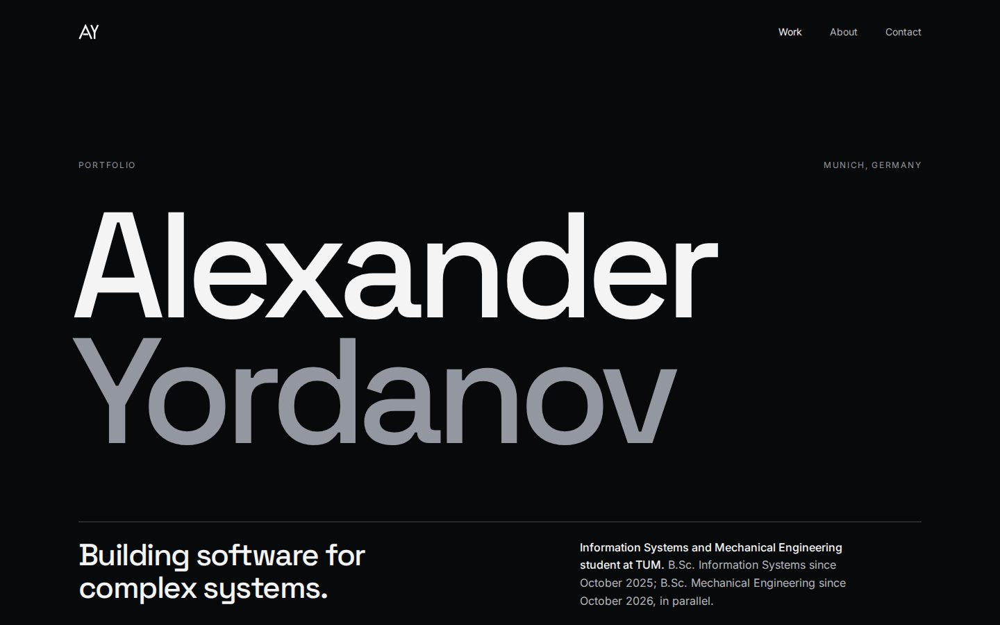
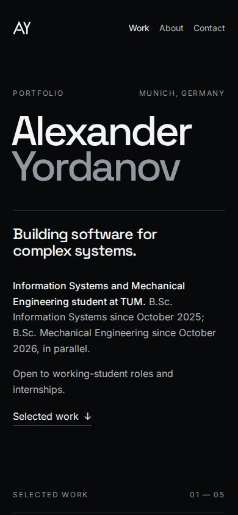
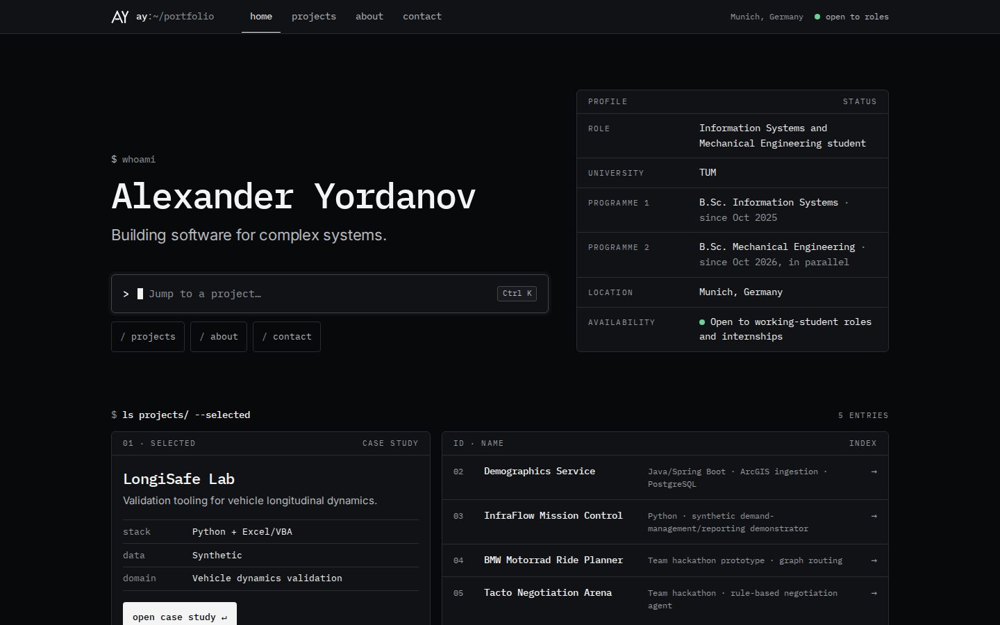
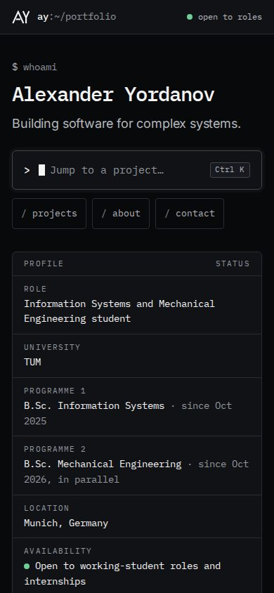
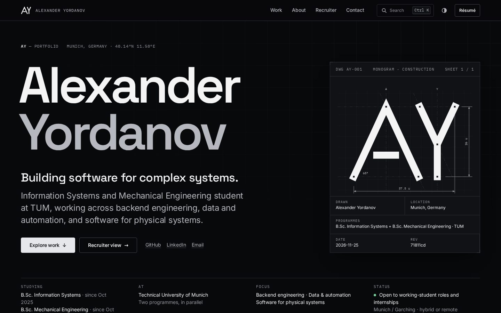
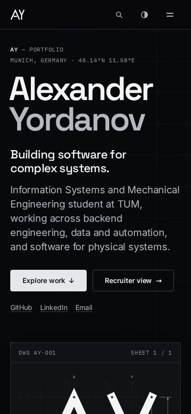

# Homepage concept exploration

Three homepage directions were rendered and compared before the styling was locked. All three use the same identity
constraints (dark, monochrome, the angular AY monogram, the same three typefaces) and the same true copy, so the
comparison is about composition and tone, not content.

- **A** and **B** are self-contained static prototypes in [`concepts/`](concepts/) (single HTML file each, inline CSS,
  no JavaScript). They cover header, hero and a selected-work slice only.
- **C** is the live site homepage, captured from the development server on 2026-11-25. Project content was still being
  added at capture time: only one project card was published, so C's work section is under-populated in these shots.

All screenshots are viewport-only at 1440 × 900 and 390 × 844, device scale factor 1, reduced motion on.

## Concept A — Premium stealth editorial

Source: [`concepts/concept-a-stealth-editorial.html`](concepts/concept-a-stealth-editorial.html)

Swiss/editorial composition. The name is the only image on the page, set as large as the viewport allows, with the
surname stepped down to grey. There is no interface chrome: the header is a monogram and three text links, there are no
buttons, boxes or cards. One strong rule separates the name from a two-column statement-and-facts block on a 12-column
grid. Work is a numbered index in display type; the first entry is enlarged and carries the only call to action.

| 1440 × 900 | 390 × 844 |
|---|---|
|  |  |

Strengths: the calmest and most legible of the three, a one-second read of who this is, trivially responsive, and almost
free to ship. Weaknesses: it shows no evidence of engineering above the fold; a project is a title and a sentence, with
nowhere natural to put a metric, a diagram or a verification status. The oversized-name-on-black layout is also a
well-worn designer-portfolio form, so it signals taste more than it signals backend or industrial software.

## Concept B — Cyber console minimalism

Source: [`concepts/concept-b-cyber-console.html`](concepts/concept-b-cyber-console.html)

A restrained operating-system surface. Monospace is the primary face. The header is a system bar with a path-style
wordmark, tabs and a live status indicator; the hero's main affordance is a command bar, with the profile presented
beside it as key/value status rows. Work is one panel for the lead project (key/value detail, one filled button) next to
a dense index table for the rest.

| 1440 × 900 | 390 × 844 |
|---|---|
|  |  |

Strengths: the highest information density per viewport (identity, status and all five projects are visible within
1.2 screens on desktop), structure that maps directly onto real data, and a tone backend engineers recognise.
Weaknesses: the `$ whoami` / `ls` terminal metaphor is the most common developer-portfolio trope there is; long
monospace lines are tiring to read; the name has little presence; a command bar as the hero promises functionality that
needs JavaScript to deliver; and the aesthetic says "developer tooling" rather than vehicles, plants or markets, so it
undersells the mechanical-engineering half of the profile.

## Concept C — Precision motorsport-inspired hybrid (live)

Source: the site homepage (`src/pages/index.astro`).

Editorial scale for the name and section headings, console discipline for metadata (mono labels, hairline rules, status
dot, command palette in the header), and one engineering artefact as the hero image: the AY monogram presented as a
dimensioned drawing sheet with a real title block. Project cards carry a small data figure, a role, one metric and the
stack.

| 1440 × 900 | 390 × 844 |
|---|---|
|  |  |

## Comparison

Scores are 1–5, higher is better. For performance cost, 5 means cheapest to ship.

| Criterion | A — Stealth editorial | B — Cyber console | C — Hybrid (live) |
|---|---|---|---|
| Visual originality | **3** — beautifully executed but a familiar big-name-on-black form | **3** — coherent, but the terminal metaphor is a cliché | **4** — the dimensioned monogram sheet is ownable; the rest leans on a familiar dark product-site vocabulary |
| Readability | **5** — sans-serif, large sizes, short measures, nothing competing | **3** — mono body at 13–14 px and dense rows slow reading | **4** — strong type scale, but the hero stacks six distinct blocks and repeats facts |
| Professional fit (healthcare/backend, industrial, quant) | **4** — safe for everyone, specific to no one | **3** — good for backend, weak for industrial; quant readers may find it stylised | **5** — the drawing sheet speaks to industrial, the data-figure cards to backend and quant |
| Responsive feasibility | **5** — one column of type; nothing to break | **4** — tables collapse cleanly; the command bar and system bar need trimming | **3** — works, but the mobile hero runs 1,600 px and the card figure clips at 390 px (see critique) |
| Content richness | **2** — title plus one sentence per project | **4** — key/value structure holds facts well, no room for visuals | **5** — figure, role, metric, stack and evidence links per project |
| Performance cost | **5** — two font files, no JS, no images | **4** — two font files; a real command bar needs JS | **4** — three font files, inline SVG, small enhancement scripts; still static |
| **Total (of 30)** | **24** | **20** | **25** |

The totals are close on purpose: A is the better pure reading experience, and C only wins if its extra content is
composed with A's discipline. The critique below lists where it currently is not.

## Decision

**The hybrid (C) is the chosen direction, as approved by the owner.** It is the only concept that can show engineering
evidence on the homepage and that addresses both halves of the profile, software and mechanical.

What C borrows from A:

- the oversized two-line name with the surname stepped down to grey, as the first thing read;
- the two-tone, tightly tracked display headings and generous section spacing;
- numbered sections and a single filled button per screen.

What C borrows from B:

- monospace uppercase labels for metadata, hairline rules and key/value fact rows;
- the status indicator ("open to working-student roles and internships") as the only colour;
- the command palette, moved from hero to header so it is an enhancement rather than a promise;
- the title-block/table logic for dense facts.

What C adds that neither has: the drawing-sheet hero graphic and data figures inside project cards.

## Critique of the live concept C

Observed from the rendered pixels at 1440 × 900 and 390 × 844, including scrolled viewports. Ordered by expected value.

1. **The feature-card figure clips on mobile.** At 390 px the Demographics Service figure is cut off at the top (the
   `GET /api/states` header sits flush against the card edge with no padding) and at the bottom, where the amber
   `CT … skipped` row collides with the `01 SOFTWARE / APPLICATION PROJECT` label, and its text truncates to "ski…".
   The figure container is held to `aspect-ratio: 16 / 9` below the desktop breakpoint, which at 347 px wide is shorter
   than the chart. Fix: let the figure
   size to its content on narrow screens (`aspect-ratio: auto; height: auto`), give it its own padding and a bottom
   border, and allow the annotation row to wrap instead of ellipsising.

2. **Mobile shows no work for two full screens.** The hero is about 1,600 px tall at 390 px: kicker, name, tagline, a
   five-line lede, buttons, social links, the 500 px drawing sheet, then four stacked fact rows. "Selected work" begins
   at roughly 1,660 px. Fix: on small screens cut the lede to `--text-md`, collapse the four fact rows into a 2 × 2 grid
   or a single two-line summary, and either move the drawing sheet below the first project or reduce it to a compact
   strip (drawing only, title block hidden). Target: the work label visible within about 1.2 screens.

3. **The hero says the same facts three times.** At 1440 px the programmes, university and location appear in the lede,
   in the sheet's title block ("Programmes", "Location", "Drawn"), and again in the fact strip ("Studying", "At"). The
   name appears three times above the fold (header wordmark, h1, "Drawn"). Fix: make the title block the single home for
   structured facts and delete the duplicates from the fact strip, or keep the strip and change the title block to
   drawing metadata only (scale, units, grid, revision). Hide the header wordmark until the h1 has scrolled away.

4. **The fact strip is cut by the fold and wraps badly.** At 1440 × 900 the strip starts at 799 px, so its second lines
   are clipped, and "since Oct / 2025" breaks mid-date in the first column. Fix: add `white-space: nowrap` to the dimmed
   date spans, reduce the hero's top padding or the name's upper clamp by about 40 px so the strip closes inside the
   first viewport, or drop the strip on desktop entirely (see item 3).

5. **The drawing sheet's annotations are too faint and the mark too heavy.** The monogram is drawn as a solid white
   stroke roughly 23 px wide while the dimension text is 11 SVG units, which renders at about 8.5 px in the 430 px-wide
   desktop sheet and smaller on mobile; "65°", "26 u" and "37.5 u" are barely legible, and the construction lines almost
   vanish. It reads as a logo in a box rather than a drawing. Fix: thin the mark (stroke about 1.6–2 units, or outline
   it with a centreline), raise dimension text to 13–14 units, strengthen construction lines to `--text-3` at full
   opacity, and add one or two more true annotations (crossbar length 7 u, stem 12 u). This is also the natural place
   for the single instrumentation accent: colour the dimension lines only.

6. **The "motorsport instrumentation" promise is almost invisible.** Apart from the green status dot and one amber row
   inside a card, the page is a grey-on-black product-site layout: pill tags, rounded bordered cards, a `Ctrl K` search
   box, two-tone headings. Fix: introduce one `--signal` accent token and use it for data and state only (dimension
   lines, the active section numeral, chart highlights); replace pill tags with a plain mono, middot-separated line;
   use square corners (`--r-1`) and corner ticks on cards so they match the sheet.

7. **Card title competes with the section heading.** "Demographics Service" in the feature card is set at about the
   same size (roughly 56 px, two lines) as the section h2 "Five projects, each with the evidence attached." directly
   above it, so the hierarchy flattens. Fix: cap the feature title at `--text-xl`/`--text-2xl` minus one step and keep
   it on one line at desktop, or shrink the section h2 and let the card title lead.

8. **The feature figure floats in empty grid.** In the 730 × 575 px figure panel the bar chart occupies the middle
   240 px, leaving about 160 px of blank grid above and below. Fix: vertically size the panel to the chart
   (`align-self: start` with padding), or scale the chart up (taller bars, larger labels) so it fills the panel; the
   empty grid currently looks like a placeholder.

9. **Section rhythm is too loose for the amount of content.** There are about 370 px between the hero rule and the work
   heading's label, about 230 px of empty space after "All projects and repository index", and a similar void under the
   capabilities grid. With few cards the page feels padded. Fix: reduce `--section` to roughly
   `clamp(3.5rem, 2.5rem + 5vw, 6.5rem)` and tighten `.sec-head` bottom margin; reserve the largest gap for the
   transition out of the hero only.

10. **Section-head paragraph is stranded.** At 1440 px the h2 sits on the left and its supporting sentence is pushed to
    the far right column, bottom-aligned, with about 300 px of empty space between them; the eye has to jump. Fix: place
    the paragraph directly under the h2 at `max-width: 46ch`, or keep two columns but align the paragraph to the h2's
    first baseline and narrow the gap to one grid column.

11. **Capability columns do not align.** In the four-column grid, headings that wrap to two lines ("Backend &
    software", "Physical & industrial systems") push their first rule 40 px lower than the single-line columns. Fix:
    give `.cap h3` a `min-height` of two lines at that breakpoint (or use `subgrid` rows), and render evidence links
    consistently, since items without one look unfinished next to items with one.

12. **Metric label outweighs its value.** "COUNTY RECORDS AGGREGATED TO STATE ROWS" wraps to two or three lines above a
    small "3,144 → 50". Fix: invert the emphasis: set the value in display type at `--text-lg` and shorten the label to
    two or three words ("Counties → states").
